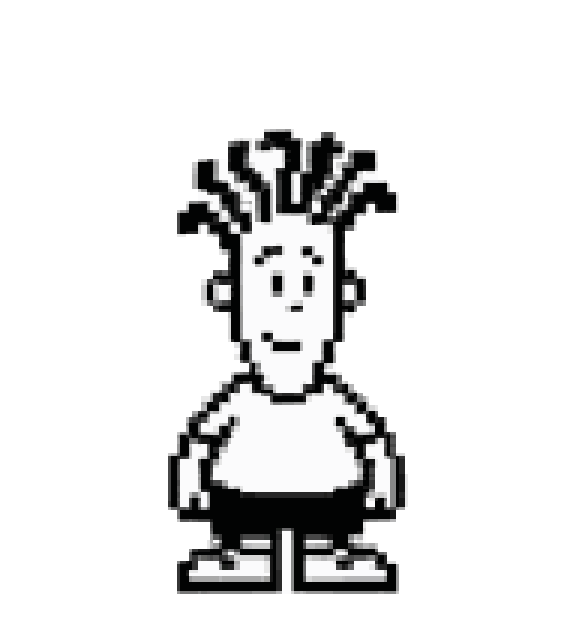

# FAT FIDO · mascota de escritorio para Windows



FAT FIDO es una mascota pixel-art en blanco y negro que vive sobre el escritorio de Windows: una ventana sin bordes, con fondo transparente, siempre visible, que se puede arrastrar y que reacciona con animaciones. Está hecha con Python y PySide6 como proyecto del curso Producto AI.

## Para quién y por qué

> **Completar (2 o 3 líneas):** quién es la persona usuaria, qué necesidad cubre una mascota de escritorio (compañía mientras se trabaja, identidad de marca, etc.) y cómo sabrías que funciona.

## Funcionalidades

- Ventana sin bordes, transparente y siempre visible.
- Movimiento por arrastre con el botón izquierdo.
- Menú contextual (botón derecho) y bandeja del sistema.
- Ajuste de tamaño y preferencias locales persistentes.
- Modo de interacción para dejar pasar los clics a través de la mascota.
- Animaciones de reposo (con parpadeo), caminar, saludar, sentarse, dormir y escribir.

## Cómo la construí con IA

- **Personaje original:** partí de un sprite pixel-art propio y de sus poses de animación, que sirvieron como referencia de identidad.
- **Prompts con restricciones:** para generar la hoja de animación pedí conservar rasgos concretos (pelo, ropa, paleta blanco y negro, contorno duro) y prohibí rediseñar el personaje como animal o mascota genérica. Usé fondo magenta plano para poder quitarlo de forma determinista. Los prompts están descritos en [`assets/native-pet/`](assets/native-pet/).
- **Herramientas:** Codex y generación de imágenes, con verificación local propia.
- **Validación antes de aceptar:** la hoja se valida por formato (PNG RGBA, cuadrícula 8×11, 73 celdas) y cada cuadro tiene su registro de procedencia (`frame-provenance.json`).
- **Corrección iterativa:** el parpadeo salió mal alineado en una primera versión; lo rehice con el cuerpo completo y comprobé píxel a píxel que el resto de la fila no cambiara.

## Decisiones de producto

- **Provisional se llama provisional.** La hoja nativa cumple el formato técnico, pero tiene poses y direcciones de mirada pendientes. Está marcada así en los READMEs de `assets/` y no se presenta como arte terminado.
- **Publicar con criterio.** Los diagnósticos, backups, prompts y trabajo temporal quedan fuera del repositorio (`.gitignore`). Solo se publica lo necesario para ejecutar y revisar.
- **Sin servicios externos en la app.** La mascota funciona localmente, sin cuentas ni conexión.

## Requisitos

- Windows 10 u 11.
- Python 3.10 o posterior.

## Instalación y ejecución

Abrí PowerShell en esta carpeta y ejecutá:

```powershell
py -3 -m pip install --upgrade pip
py -3 -m pip install -r requirements.txt
py -3 main.py
```

La mascota aparece en el escritorio. Botón izquierdo para arrastrarla, botón derecho para abrir su menú. La app puede crear `settings.json` con preferencias locales; ese archivo no forma parte del repositorio.

## Estructura

- `main.py`: aplicación principal.
- `mascota_master.png`: sprite maestro del reposo.
- `sprites_revision_v2/`: sprites usados por las animaciones.
- `assets/native-pet/`: hoja de animación nativa en revisión. Es **provisional**: el formato está validado, pero faltan poses y direcciones con arte definitivo.
- `requirements.txt`: dependencias.

## Estado

Proyecto personal en desarrollo. Pendiente: reemplazar los placeholders de la hoja nativa por poses aprobadas y revisar los 16 sentidos de mirada.

## Tecnologías

Python · PySide6 (Qt) · Pillow
